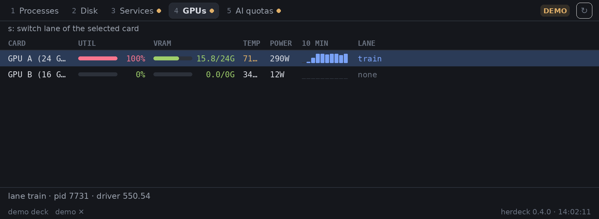

# herdeck

Your herdeck dashboards as a native Herdr panel: one tab per entry in your herdeck deck (processes, disks, health
checks, JSON APIs, Prometheus queries, your own scripts), each a live, colour-coded table with real bars and
sparklines drawn by the app, not a terminal. Open it over the window with a key, or keep it as a pane beside your
terminals; it follows your theme, light or dark.

## What you see

Top to bottom, full width of the pane or overlay (the same at every size; columns adapt):

- **Tab strip**, 32px, bottom border `border`. Pills 24px high, 6px corners, 12px text: a dim 11px mono index
  (1–9) then the tab name (max 140px, truncated). The shown tab is `raised` with a 1px `border` and `foreground`
  text; others are `muted`, `hover` on hover. A 6px dot follows a name: red-ish (`ansi9` dark / `ansi1` light) for
  a tab that failed or timed out, yellow (`ansi11` / `ansi3`) for demo, not set up or stale data. The strip scrolls
  sideways when tabs don't fit. On the right: a status chip, a ↻ button, and ✕ when opened as an overlay.
- **Status chip**, 18px, 10.5px semibold capitals on a 15% tint of its colour: `DEMO`, `NOT SET UP`, `STALE`
  (yellow), `ERROR`, `TIMEOUT` (red), or the tab's note (`partial: 1 runner offline`) in `accent`. Hidden under 300px.
- **Header line**, 22px, 11.5px `muted`: the tab's own header (`212 processes (all), sorted by cpu`).
- **Column titles**, 22px, 11px mono `dim`, bottom border. `+3` at the right when columns didn't fit.
- **Rows**, 24px each, 12px mono, 12px between columns, 12px side padding. Text cells in their tone:
  ok green (`ansi10`/`ansi2`), warn yellow, bad red and semibold, accent (`accent`), dim (`dim`), else `foreground`.
  Bar cells: a 6px rounded track in `border` with a fill in the bar's tone (green under 70%, yellow from 70%, red
  from 90% of max), then the right-aligned label (`93%`, `15.8/24G`). Sparklines: one thin column per value, up to
  14px high, in `accent`; zero values are 1px `border` ticks. Section rows: an 11px semibold `muted` title and a 1px
  rule. The selected row is `selected`.
- **Detail line**, 30px, top border, 12px `muted`: the selected row's detail (`connection refused`), followed by
  the columns that didn't fit (`MEM 12.4% · UP 02:14:09 · COMMAND cargo build --release`). Absent when empty.
- **Footer**, 22px, 11px `dim`: the deck (`~/.config/herdeck/tabs.toml`, or `vps · …` for another machine,
  `demo ✕` when showing sample data) on the left; `herdeck 0.4.0 · 14:02:11` (the shown tab's last update) on the right.

At 260px (a sidebar) wide columns shrink first, then trailing columns fold into the detail line; at 420px most
decks fit; at 900px everything shows and the last text column takes the rest.

## How it behaves

- **Agent statuses:** none. It shows your herdeck deck, not agents; working/blocked/done/idle don't appear.
- **Tab states:** OK shows the table. Demo and not-set-up show herdeck's sample or to-do rows with a yellow chip.
  A tab that fails keeps showing its last good table with `STALE` and "stale since 14:02:11" in the footer; with no
  earlier table it says "Couldn't read this tab", the reason, and Retry. Loading shows a braille spinner and
  "Reading your deck…".
- **Whole-panel states:** herdeck missing ("herdeck isn't installed here", with install commands), too old
  ("needs herdeck 0.4.0 or newer"), newer data version ("update the herdeck mod"), no deck yet ("Set up in a
  terminal" opens herdeck's own picker in a new tab; "Show sample data" switches to demo), deck error (the TOML
  error, Retry). These retry by themselves every 30s.
- **Refresh:** the shown tab refreshes at its own `interval` from the deck (at least every 2s apart); other tabs
  refresh when you switch to them and their data is older than their interval. Nothing refreshes while the window
  isn't active or a docked panel is hidden; a pane or tab copy that is merely out of sight keeps polling at its own
  interval (Herdr runs a mod's timers while hidden), so close it when you don't want that. ↻ or `r` refreshes now; ↻ spins while reading.
- **Clicks:** a pill shows that tab; a row selects it; the wheel scrolls the rows; ✕ closes the overlay.
- **Keys** (after clicking the panel): `]`/`Tab` next tab, `[`/`Shift-Tab` previous, `1`–`9` a tab, `j`/`k` or arrows
  a row, PageUp/PageDown, `g`/`G` or Home/End, `r` refresh, the key of a row action (`s` on a GPU card) opens its dialog, Esc closes the overlay. `ctrl-shift-h` (keys.json)
  opens or closes the overlay from anywhere.
- **Hover:** pills and the buttons highlight in `hover`; chips show the full status as a tooltip. Rows have no hover
  tint (handlers can't live in the virtual list's row renderer; rows only show the selected state).

## Built from

- **One mod, `mods/herdeck/`**: `main.js` (the view), `model.js` (pure helpers: tone colours, column widths),
  `mod.json` `{ "place": "none", "title": "herdeck", "focusable": true, "overlay": { "width": 760, "height": 460 } }`.
  No layout file and no images.
- **Props** (all optional): `bin` (herdeck's path), `config` (a deck file), `machine` (omitted: this computer,
  `"follow"`: the shown space's machine, or a machine name), `demo`, `block` (the layout block id when docked, so it
  can pause while hidden).
- **Opening it:** `mod.open {name: "herdeck"}` (the key), `pane.split {direction: "right", mod: "herdeck"}` or
  `tab.new {mod: "herdeck", name: "herdeck"}`. Docked: a block `{ "content": { "mod": "herdeck", "props": { "block": "herdeck" } } }`
  in your own copy of a layout (`layout.clone`).
- **Programs it runs:** only `sh -c <launcher>`, which sources `~/.config/herdeck/env` if present (as herdeck's
  plugin pane does) and runs the first executable it finds of: the `bin` prop, `$HERDECK_BIN`, `herdeck` on PATH,
  `~/.local/bin`, `~/.cargo/bin`, `/opt/homebrew/bin`, `/usr/local/bin`, then the herdr TUI plugin's copy,
  `${XDG_CONFIG_HOME:-~/.config}/herdr/plugins/*/herdeck*/bin/herdeck` (a shell glob, POSIX `sh`). It calls
  `herdeck --json --timeout 15 [--tab N] [--demo] [--config PATH]` through `exec` (on the chosen machine), and
  `herdeck --act TAB ROW KEY CHOICE [--demo] [--config PATH]` (the one call that changes something on a server: a GPU lane
  switch, only after the person confirms in the dialog), and `tab.new {argv: [herdeck]}` for first-time setup. It reads no other files and makes no network requests itself;
  your deck's tabs do whatever the deck says.
- **herdr functions:** `exec`, `props`, `theme`, `settings` (`dark`, `font_family`), `window` (`active`), `layout`,
  `spaces`, `run`, `closeOverlay`, `nextCommand`, `localStorage`. gpui-kit: `v_virtual_list` + `on_item_click` +
  `VirtualListScrollHandle` + `Scrollbar.vertical`, `track_focus`/`on_key_down`, `on_size_change`, `frames`.
- **Data:** `herdeck --json` (herdeck 0.4.0+), `schema: 1`: `tabs[]` with `index`, `name`, `type`, `interval`,
  `state` (`ok`, `demo`, `not_set_up`, `error`, `timeout`, `skipped`), `status`, `message`, `table`
  (`header`, `columns`, `rows`); a row is `{cells, detail?, key?}` or `{section}`; a cell is
  `{kind:"text", text, tone}`, `{kind:"bar", value, max, text, tone, width}` or `{kind:"spark", values, max, tone, width}`;
  tones `ok|warn|bad|accent|dim|null`. Fatal: `{schema, error: {kind: no_deck|config|no_such_tab, message, path}}`.
  Full contract: `docs/json.md` in the herdeck repo.

## Watch out

- **herdeck isn't on herdr-core's PATH** when it lives in `~/.local/bin` or `~/.cargo/bin`: never `exec("herdeck")`
  directly; use the `sh` launcher.
- **Each poll is a new herdeck process**, so the `http` tab's latency TREND has at most one point here (herdeck keeps
  that history only while running). Stale data is tracked by the panel, not by herdeck.
- **herdeck older than 0.4.0** answers `--json` with exit 2 and `unknown argument "--json"`; show "too old", not an error dump.
- **Parse stdout before looking at the exit code:** fatal documents come with exit 1.
- **No click handlers inside `v_virtual_list` rows** (they throw): select rows with the list's `on_item_click`.
- **Column widths assume a 12px mono font** (7.2px per character); each column gets one character of slack; cells still truncate if your font is much wider.
- **Row actions:** a row that lists `actions` in `herdeck --json` (the GPU tab's `s` switch lane) gets an
  action button in the detail line and its key. It opens a confirm bar with one choice per row (a long
  name wraps onto a second line, it is never cut): click or ↑/↓/←/→/`j`/`k`/`h`/`l`/Tab/`s` to pick, `y`/Enter confirm,
  `n`/Esc cancel. Every other key is ignored while it is open, and showing another tab or switching machine closes
  it; it remembers the machine it was opened for, so a confirm can never go to another host. After confirming it
  runs `herdeck --act`, shows the result, and looks at that tab again at 1.5s, 5s and 12s. Other per-tab TUI keys do nothing in the panel.
- Linux and macOS only (it needs `sh`; herdeck ships for both). A machine without herdeck shows the install card.
- Two open copies (a pane and the overlay) each poll.
- **Remote machines:** with a `machine` prop the launcher goes through herdr-core's `exec`; whether it keeps `sh -c`'s
  arguments as separate argv elements or joins them into one remote shell line is not documented and untested here.
  Locally nothing is shell-parsed, but a row key or lane id containing quotes has not been tried on a remote machine.
- **Key on macOS:** `keys.json` ships `ctrl-shift-h`; macOS users may prefer `cmd-shift-h`. `mod.open`'s presentation
  (dialog/popup/window, `mod.json` `overlay` size) is undocumented: only a desktop run shows it. v1 ships no layout
  and no floating drawer; to dock it, `layout.clone` a layout and add a block with `"props": {"block": "<its id>"}`.
- **Row hover** is not drawn and the virtual list's row renderer is not run by `herdr-app check` (it runs at layout
  time), so row drawing is only proven on a display.
- Key spellings in `on_key_down` (`]`, `shift-tab`, `shift-g`, `pagedown`) follow GPUI's `Keystroke::unparse`; unverified headless.

## Done when

- `scripts/check-mod.sh` exits 0: the real mod, 17 fixture shims (each also runs `selftest()` from `model.js`), three
  fatal-document shims, and the static greps (no `setTimeout`/`setInterval`/fetch/process, no colour literals, only the four imports).
  The script and the fixtures (`docs/json/`) live in the herdeck repo; building from this recipe alone, use
  `herdeck --json --demo` for the sample deck.
- `herdr-app check mods/herdeck` passes, and so does each fixture shim (sample decks at 260, 420 and 900px, every
  tab active once, the no-deck, deck-error and newer-schema documents).
- With the `docs/json/sample-demo.json` fixture, the panel shows five tabs; Services and GPUs carry `DEMO` and a
  yellow dot; GPU A's UTIL bar is full and red, its VRAM bar about two-thirds and green.
- At 260px the Processes tab shows PID, USER and CPU, `+3` in the titles, and MEM/UP/COMMAND in the detail line.
- Making one tab's command fail keeps its last table with `STALE` and "stale since …"; fixing it clears both.
- Without herdeck the panel says it isn't installed; with herdeck 0.3.0 it says it's too old; with no deck,
  "Show sample data" switches to the demo deck and "Set up in a terminal" opens herdeck's picker in a new tab.
- `]`, `j`, `r` work after clicking the panel; `ctrl-shift-h` opens and closes the overlay; Esc closes it.
- Hiding a docked herdeck panel stops new herdeck processes from starting.
